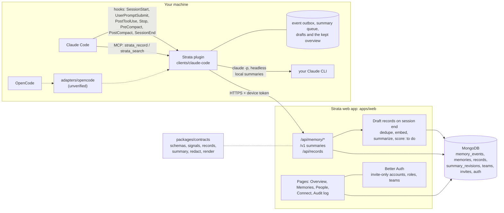

# Strata

Long-term memory for coding agents. Strata captures what happens in your Claude Code sessions, keeps what's worth
remembering, and gives it back to the next session without breaking the prompt cache. Compacted summaries sit on top,
so a long history stays small.


The diagram's source is [`docs/how-strata-works.excalidraw.json`](docs/how-strata-works.excalidraw.json). Open it at
excalidraw.com or with the VS Code Excalidraw extension, and export it again as `docs/how-strata-works.svg` after a
change.

## What's built so far

**The web app** (Next.js 16, `apps/web`) has invite-only accounts with roles, teams and suspension, API keys you make per
machine, and the memory API: capture, recall, the frozen block, compaction summaries, save and forget. It also serves
the `/v1` summary API and the records review API. Every route checks a bearer key first and validates its body against a
shared contract. **MongoDB** (Atlas) holds events, memories, summaries, records, projects, teams,
invitations, an audit log and the keys, with a vector index for recall and a text index behind it.

**The Claude Code plugin** (`clients/claude-code`) has two write paths. It emits contract-v1 events to the memory API
(prompt, assistant, tool signals, transcript, session context and findings); the server drafts records from them, and
only their author sees a draft until they approve it. It also keeps the local summary path: `claude -p` folds each turn
into a summary, you review and approve it, and only approved summaries go to `/v1`. **The pages** show what's
remembered, the People/admin view, what awaits review, and every change in the audit log, in light and dark and on a
phone. It's covered by unit tests, database tests against the real engine, and acceptance tests that run the plugin's
hooks as real processes. The rest is in the to-do below, which an
[Anything Factory](https://github.com/Erik-Koning/Anything-Factory) team is now working through.

## Architecture



Only the API touches the database. The memory API uses `packages/contracts`; the plugin carries its own summary schema
and an event outbox for now.

**One session, as the plugin sees it:**

```mermaid
sequenceDiagram
  participant C as Claude Code
  participant P as Strata plugin
  participant L as local claude -p
  participant A as Strata API
  C->>P: SessionStart
  P->>A: session start event (git, refs)
  P->>P: keep the repo overview from earlier summaries
  P-->>C: overview as context, kept for this session
  loop every turn
    C->>P: UserPromptSubmit
    P->>A: prompt event (redacted, promptID)
    C->>P: PostToolUse / Failure
    P->>A: tool signal (name, status, duration, command class)
    C->>P: Stop
    P->>A: assistant event; starts the local summarizer
    P->>L: fold the turn into the session summary
    P->>P: delete the raw turn text
  end
  C->>P: PreCompact / PostCompact
  P->>A: transcript and compaction summary events
  C->>P: SessionEnd
  P->>A: session end; server drafts records for review
  P->>A: flush approved summaries to /v1
```

**The rule both paths follow:** nothing is shared with a teammate without the engineer's review. The event path sends
redacted prompt, reply, tool and finding events to the memory API, where the server drafts records; a draft is its
author's alone until approved. The summary path sends only a summary the engineer approved. The rest:

- secrets and `<private>` blocks are stripped before anything is queued, and the server redacts again;
- a tool event carries its name, outcome, duration, command class, exit code and a fingerprint, never its input or
  output; a shell command's text never leaves the machine;
- raw prompt, reply and transcript events stay in `memory_events` until the 30-day TTL, as my-day keeps them; the
  local summary path deletes its own queue text once the summary is written;
- the local summarizer runs headless with no tools, no MCP, no slash commands, its own empty working directory, a
  small model, and a daily cap;
- the `SessionStart` overview is built from local summaries and kept for the session, so a resume gets the same bytes;
- every event and every approved revision is uploaded with an idempotency key, and a retry never stores it twice.

The data model, who can do what, and how each hook maps to the client are in [`docs/architecture.md`](docs/architecture.md).

| Part                     | Where                    | What it is                                                                         |
| ------------------------ | ------------------------ | ---------------------------------------------------------------------------------- |
| Web app and API          | `apps/web`               | Next.js 16, App Router, Better Auth, the MongoDB driver, Tailwind                  |
| Memory logic             | `apps/web/server/memory` | ingest, extract, recall, frozen, compress, forget, save                            |
| AI provider              | `apps/web/server/ai`     | one interface; `stub` (deterministic, offline) is the only one yet                 |
| Claude Code plugin       | `clients/claude-code`    | hooks, event outbox, records capture, summary dashboard, MCP server; no build step |
| Contracts                | `packages/contracts`     | contract version, schemas, signals, records, summary, `redact`, render             |
| Plugin marketplace       | `.claude-plugin`         | lets Claude Code install the plugin from this repository                           |
| The factory team's rules | `.a6g`                   | the brief, notes, rubric and adapters the team works to                            |

## To-do

What's left, in the order the team is working through it. Each group is one journey in the team's task graph.

The groups from **Contracts** to **Pages for work records** come from the plan review of 14 November 2026
([`docs/plan.md`](docs/plan.md)). They turn Strata from personal agent memory into reviewed work records that a team
can read. They aren't in the team's task graph until `.a6g/brief.md` takes them.

**Done: the foundation**

- [x] Workspace: pnpm, TypeScript, Biome, Vitest; the gate the team's merge queue runs
- [x] Accounts, sessions and per-person API keys
- [x] MongoDB collections, indexes and the vector index, created by `pnpm db:indexes`
- [x] The memory API: events, recall, frozen, compress, forget (with a preview), save
- [x] Extraction: what the user says to remember becomes an active memory; anything else is a candidate
- [x] The Claude Code plugin: event capture, local summaries, review, redaction, MCP tools, marketplace
- [x] The pages: Overview, Memories, Connect, Audit log

**Test harness**

- [ ] Playwright suite and page checks (axe, overflow, touch targets) at desktop, laptop and phone, light and dark
- [ ] End-to-end journeys: sign up, make a key, a session's memory shown, keep a candidate, forget with its cascade

**OpenCode plugin**

- [ ] Verify the real `@opencode-ai/plugin` API against the brief's sketch: hook names, event fields, timeouts,
      storage, whether a prompt edit shows in the TUI
- [ ] `.opencode/plugins/memory`: `index.ts`, `api.ts`, `outbox.ts`, `freeze.ts`, `render.ts`, `redact.ts`, `tools.ts`
- [ ] The OpenCode sandbox (`scripts/oc-sandbox.sh`) and the stub OpenAI-compatible provider on port 9318
- [ ] Acceptance through a fake plugin host: the same system bytes across requests and restarts; with the API down,
      prompts go on and the outbox drains with no duplicates
- [ ] Bundle `@strata/contracts` into the plugin, as the Claude Code client does: once installed outside this
      repository it can't import the workspace package

**Memory pipeline**

- [ ] Jobs on a schedule (`POST /api/jobs/run`): extract > dedupe > embed > summarize > score > policy
- [ ] Dedupe beyond identical text: near-duplicates, and `supersedes` when a memory replaces another
- [ ] Real providers behind `server/ai/provider.ts`: OpenAI embeddings, Anthropic for compress and extract
- [ ] Scoring and expiry: confidence that changes with use, `expiresAt`, archiving what goes stale
- [ ] `scripts/check-cache.ts`: proof with a real key that cache-read tokens don't drop after turn 2

**Governance**

- [x] Invite-only accounts; roles (engineer, manager, executive, admin), teams, suspension; the People page and the
      admins' log of access changes (`pnpm invite <email>` makes the first admin)
- [ ] Home views by role, over approved records (everyone sees those; private memory stays its owner's): pain points
      and context gaps for engineers; features and who worked on them for managers; progress for executives. Who,
      never how much: no counts, rankings or activity about people
- [ ] Summaries shown and forgettable, with what they were made from
- [ ] Provenance one click away: the session, the message and the event behind a memory
- [ ] Memories for every project (`*`) set from the page; editing a memory as a superseding one
- [ ] Bulk keep and archive for candidates; pagination tested at scale

**Contracts**

- [x] A payload schema for each event kind, in place of `z.record(z.string(), z.unknown())`; each event checked on
      its own, so one bad event is refused alone (202 with `rejected`)
- [x] A contract version on every event (`v`, now 1); within a version changes only add; kinds, versions and fields
      the API doesn't know yet are kept, not refused; `upgrade_required` (426) for clients too old
- [x] The `finding` event (what `record_finding` sends) and generic links (`Ref`: ticket, PR, commit, doc)
- [x] Record shapes the API answers with: kind, status, sources, the review update (with `/api/records`)
- [x] Example events (`@strata/contracts/examples`) that the contract's and the API's tests accept
- [ ] A plugin test that every event its hooks queue parses as known with `parseEvent`: the plugin carries its own
      outbox and copies the signals, so this needs `@strata/contracts` bundled into it first

**Records and review**

- [x] A `records` collection: kinds `summary`, `insight`, `workflow`, `pain_point`, `context_gap`; statuses `draft`,
      `approved`, `discarded`; an edited flag; the session and links; the events each record came from
- [ ] An Anthropic provider behind `server/ai/provider.ts` that drafts a session's records when the session ends
- [x] `/api/records`: list, read, edit, approve, discard; only the author sees a draft
- [x] MCP tool `strata_record` logs an insight, workflow finding, pain point or context gap as a `finding` event
- [x] Approved insights and workflow findings copied into memories, so the next session recalls them
- [ ] Delete prompt, reply and transcript text as soon as a session is drafted; for now it stays until the 30-day
      `memory_events` TTL, matching my-day
- [ ] Choose the embeddings model: OpenAI, as the brief proposes, or Voyage AI

**Capture for work records**

- [x] Session links from the plugin: repository, branch, HEAD commit, folder, and ticket keys parsed from the branch
      name; sent at the start and again when the branch or commit changes
- [x] Tool signals without content: how long each call ran; for a shell command, its kind (test, build, typecheck,
      lint, format, install, git), its exit code when it failed, and a fingerprint to count re-runs
- [ ] The pull request for a session's branch, looked up on GitHub (read-only)
- [ ] The session-start block also carries the product overview and open context gaps (fetched at startup only, so
      the cache rule holds)

**Teams and products**

- [ ] Organisations, in place of the single `default` organisation
- [x] Roles (engineer, manager, exec, admin), teams, invites and suspension, with a permission filter on every read
- [ ] A `products` collection mapping repositories to products
- [ ] `/api/products/:id`: the overview, tickets and PRs, and approved records

**Roll-ups**

- [ ] Ticket and PR summaries, made from approved records only, with the ids of the records behind them
- [ ] Product overviews, rewritten from the layer below on each roll-up

**Pages for work records**

- [ ] Review queue: drafts grouped by session; approve, edit, discard, bulk approve
- [ ] Session page: the summary, its findings, its links, and where each finding came from
- [ ] Products: a list, then each product's overview, tickets and PRs, insights, workflow notes, pain points and open
      gaps
- [ ] Friction: pain points and context gaps grouped by repository, with how often each repeats
- [ ] What others see about me: a person's view of exactly what viewers see about their work
- [ ] Organisation settings: members, roles, and which repository belongs to which product
- [ ] Overview reframed around what's awaiting review, products and friction; Memories renamed Agent memory

**Shipping**

- [x] Dockerfile for `apps/web` (standalone, not root, health check), and `pnpm deploy:web` to AWS Lightsail at
      https://strata.anythingfactory.dev
- [ ] GitHub Actions running the gate and the end-to-end suite against an Atlas-local service container
- [ ] `docs/architecture.md`: backups and restore (`mongodump`), HTTPS, logs, Dependabot
- [ ] Rate limits on the API, and a size limit on event batches
- [x] Email sending: strata.anythingfactory.dev an Amazon SES sender (DKIM, DMARC, its own MAIL FROM), a send-only
      key per stage (`sst.config.ts`), and `sendMail` in `apps/web/server/mail.ts`; `pnpm mail:test <email>` checks it
- [ ] The emails themselves: confirming a new account's address and resetting a password, through Better Auth and
      `sendMail` (links use `BETTER_AUTH_URL`)

## Run it

You need Node 24 and pnpm. Local development runs on the team's MongoDB Atlas cluster, so there's no database to start:
put its address in `.env.local` at the repository root, once (it's gitignored).

```sh
pnpm install
echo 'MONGODB_URI=<the cluster address>' >> .env.local
pnpm invite you@example.com           # no account yet? prints a sign-up link (an admin's, by default)
pnpm dev                              # http://localhost:9316 (set PORT in the shell to change it)
```

The app, the scripts and `pnpm test:db` read `.env.local` from `apps/web`, then the repository root, then, in a git
worktree, the main checkout, so a new worktree runs with nothing to copy; a variable set in the shell wins. The
cluster is production: `pnpm test:db` works in a throwaway database it removes afterwards, but `pnpm invite` and
`pnpm db:seed` write to the real one.

Open the link to make your account (accounts are by invitation; invite everyone else from **People**), then open
**Connect** and follow its steps: install the plugin, point it at the app, sign in.

```
/plugin marketplace add Erik-Koning/Strata
/plugin install strata@strata
```

The plugin finds the app at `STRATA_URL` (set it in `~/.claude/settings.json` under `env`, or in your shell). Then run
`/strata:login` in Claude Code: it opens the app's `/activate` page, you approve the sign-in there, and the plugin keeps
its token in `~/.strata/auth.json`. It needs no API key; the keys on **Connect** are for scripts and other clients.

To run the plugin from this checkout against the dev server, with a sign-in kept apart from your everyday one:

```sh
STRATA_URL=http://localhost:9316 STRATA_HOME=~/.strata-dev claude --plugin-dir clients/claude-code
```

`STRATA_HOME` is where the plugin keeps its sign-in, settings and local drafts (`~/.strata` by default). The API the
plugin talks to is described in [`clients/claude-code/docs/api-contract.md`](clients/claude-code/docs/api-contract.md).

## Deploy

The web app runs on AWS Lightsail at https://strata.anythingfactory.dev, built from the `Dockerfile` (Next.js's
standalone server, not root, on port 3000). One command builds the image for `linux/amd64`, pushes it to ECR, and
deploys it; the first time it also makes the Lightsail service (micro, about $10 a month), the app's settings in SSM,
and the domain's certificate and DNS records:

```sh
AWS_PROFILE=<the account's profile> pnpm deploy:web --check   # read-only: what exists, what a deploy would do
AWS_PROFILE=<the account's profile> pnpm deploy:web           # build, push, deploy; --skip-build reuses this commit's image
```

The settings live in `/strata/production/web-env` (an SSM SecureString): `MONGODB_URI`, taken from `.env.local` on the
first run, a session secret made then, and `BETTER_AUTH_URL`. The mail settings come from `/strata/production/mail-env`
(`sst.config.ts`). Neither ever goes in the image or the output. The cluster's Network Access list has to let Lightsail
in; its addresses aren't fixed.

## The API

Every route takes `Authorization: Bearer <key>` and answers `{ error: { code, message } }` when it fails. The scope
is `{ project }`; the organisation and the person come from the key.

Every event carries the contract version it was written to (`v`). The contract only grows within a version, and the API
keeps what it doesn't understand yet rather than refusing it: the rules are in
[`docs/architecture.md`](docs/architecture.md#the-contract-and-how-it-changes).

| Route                       | Body                                                                     | Answer                                                    |
| --------------------------- | ------------------------------------------------------------------------ | --------------------------------------------------------- |
| `POST /api/memory/events`   | `{ batch: [{ v, id, sessionID, scope, kind, payload, ts, promptID? }] }` | 202 `{ accepted, duplicates, rejected }`, deduped on `id` |
| `POST /api/memory/recall`   | `{ sessionID, scope, query, k }`                                         | `{ memories: [{ _id, kind, text }] }`                     |
| `GET /api/memory/frozen`    | `?sessionID&project`                                                     | `{ memories }`, the same for the same data                |
| `POST /api/memory/compress` | `{ sessionID, scope, messages }`                                         | `{ summary }`                                             |
| `POST /api/memory/forget`   | `{ scope, ids \| query, dryRun? }`                                       | what went: memories, summaries, events                    |
| `POST /api/memory/save`     | `{ scope, text, kind }`                                                  | 201 `{ memory }`                                          |
| `GET /api/health`           |                                                                          | `{ ok, db, search, contract: { min, max } }`              |

The Claude Code client also uses the summary and review APIs:

| Route                                         | Body / query                    | Answer                                     |
| --------------------------------------------- | ------------------------------- | ------------------------------------------ |
| `POST /v1/auth/device`, `POST /v1/auth/token` | `{ client }`, `{ device_code }` | device sign-in; the token is an API key    |
| `GET /v1/me`, `GET /v1/projects`              |                                 | the person, their projects                 |
| `POST /v1/events`                             | approved `session_summary`      | 201 first, 200 duplicate, `{ ok: true }`   |
| `DELETE /v1/sessions/:id`                     |                                 | retract every summary revision             |
| `GET /v1/search`, `GET /v1/rollups`           | `q`, `projectId`                | approved summaries                         |
| `GET /api/records`                            | `status`, `kind`, `project`     | records the caller may see                 |
| `GET/PATCH /api/records/:id`                  | `title`, `text`                 | read or edit a draft                       |
| `POST /api/records/:id/approve`               |                                 | approve it; insights/workflow go to memory |
| `POST /api/records/:id/discard`               |                                 | discard it                                 |

## Develop

| Command                | What it runs                                                      |
| ---------------------- | ----------------------------------------------------------------- |
| `pnpm typecheck`       | TypeScript across the web app and contracts                       |
| `pnpm lint`            | Biome (lint and format), read-only. `pnpm format` fixes           |
| `pnpm test`            | Unit tests and the client suite: no database, no external network |
| `pnpm test:db`         | API, records and database tests on throwaway databases            |
| `pnpm test:acceptance` | The client's hooks, CLI and dashboard as real processes           |
| `pnpm build`           | `next build` (the plugin has no build step)                       |
| `pnpm db:indexes`      | Every index, the vector index included, idempotently              |
| `pnpm db:seed`         | Made-up memories for a made-up user, on `MONGODB_URI`'s database  |

Embeddings and summaries go through one interface (`apps/web/server/ai/provider.ts`). The default, `stub`, is
deterministic and offline, so every test runs without a key.

Built by an [Anything Factory](https://github.com/Erik-Koning/Anything-Factory) team; its rules and brief are in
`.a6g/`.
