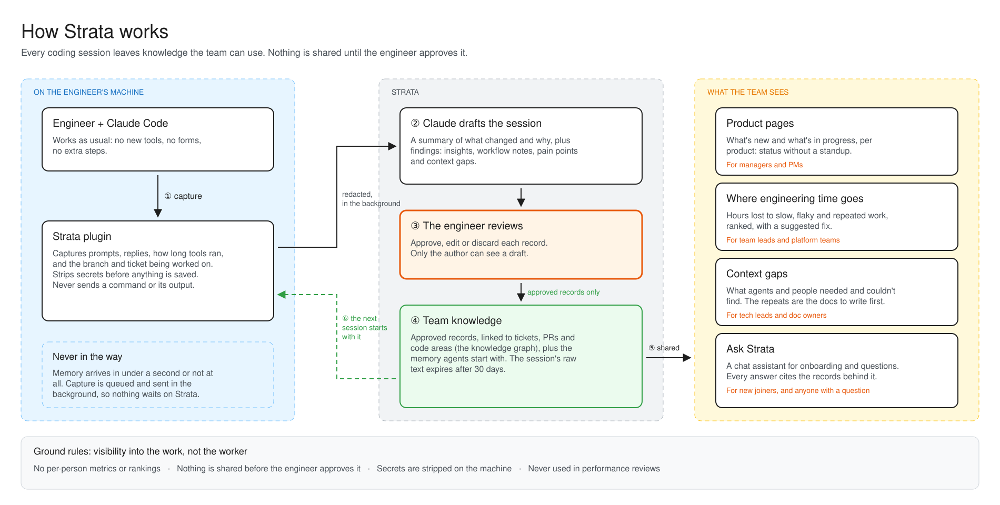
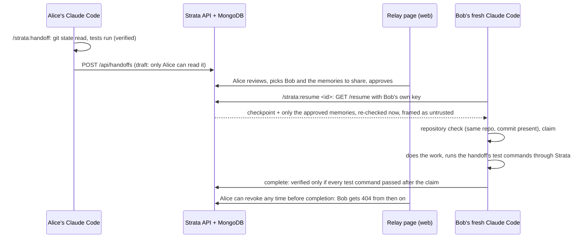
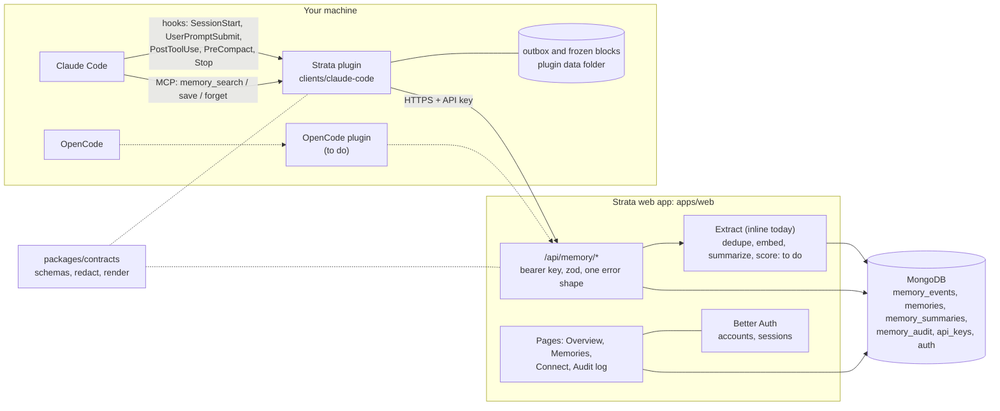
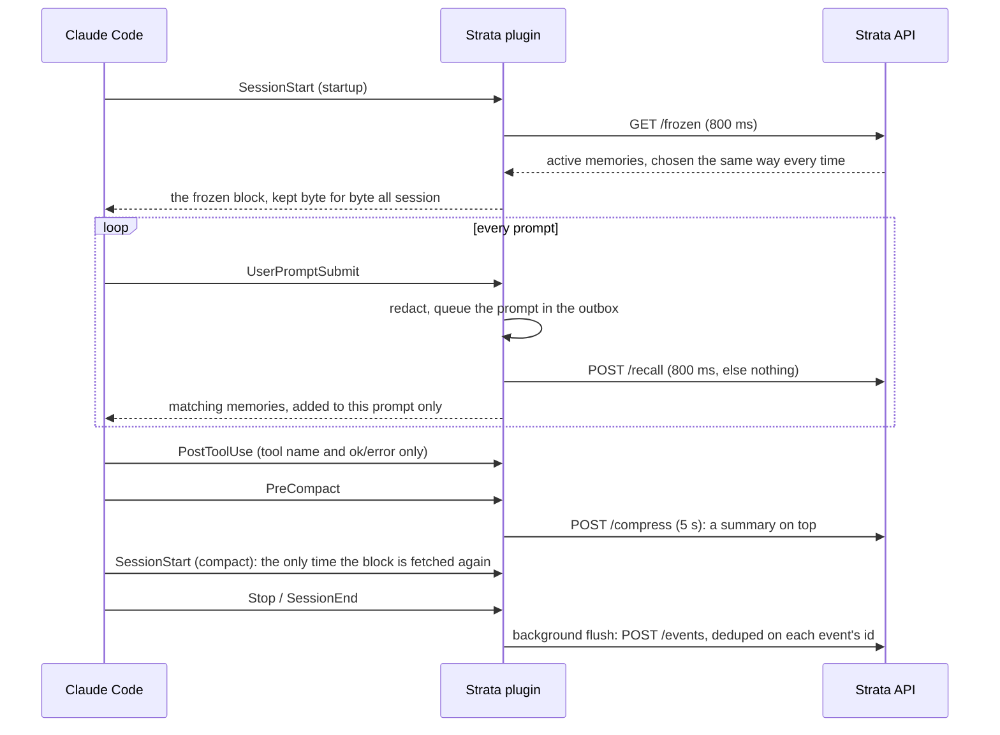

# Strata

Long-term memory for coding agents. Strata captures what happens in your Claude Code sessions, keeps what's worth
remembering, and gives it back to the next session without breaking the prompt cache. Compacted summaries sit on top,
so a long history stays small.



The diagram's source is [`docs/how-strata-works.excalidraw.json`](docs/how-strata-works.excalidraw.json). Open it at
excalidraw.com or with the VS Code Excalidraw extension, and export it again as `docs/how-strata-works.svg` after a
change.

## Strata Relay: hand unfinished work to another engineer

Relay lets Engineer A hand a task in progress to Engineer B, whose **fresh** Claude Code session picks it up from a
verified checkpoint, not a raw conversation.



| Status      | Who can read it           | Who can change it                                      |
| ----------- | ------------------------- | ------------------------------------------------------ |
| `draft`     | the sender                | the sender: edit, approve, record tests, revoke        |
| `approved`  | the sender, the recipient | the recipient claims; the sender revokes               |
| `claimed`   | the sender, the recipient | the recipient records tests, completes; sender revokes |
| `completed` | the sender, the recipient | nobody                                                 |
| `revoked`   | the sender                | nobody                                                 |

Anyone else, any id that doesn't exist, and a draft or revoked handoff asked for by its recipient all get the same
`404`. A test result is **verified** only when Strata's client ran the command and captured its exit code; anything
typed is a claim, and is shown as one. Uncommitted changes don't travel, and a commit that isn't pushed is a blocker the
recipient's session names rather than works around.

- The contract: [`packages/contracts/src/handoff.ts`](packages/contracts/src/handoff.ts)
- The server: [`apps/web/server/handoffs/`](apps/web/server/handoffs) (the rules are in `lifecycle.ts`)
- Claude Code: [`clients/claude-code/src/relay.ts`](clients/claude-code/src/relay.ts), with `/strata:handoff` and
  `/strata:resume` in [`clients/claude-code/commands/`](clients/claude-code/commands)
- The page: `/relay` in the app
- The demo, end to end with real Claude Code sessions: [`demo/relay/`](demo/relay) (`node demo/relay/run.mjs`)
- Progress and what's verified: [`HACKATHON_STATUS.md`](HACKATHON_STATUS.md)

## What's built so far

On 14 November 2026 Strata went from an empty repository to a working loop, end to end. **The web app** (Next.js 16,
`apps/web`) has accounts with email and password, API keys you make per machine, and the whole memory API: capture,
recall, the frozen block, compaction summaries, save and forget. Every route checks a bearer key first and validates its
body against a shared contract. **MongoDB** (the Atlas-local image) holds events, memories, summaries, an audit log and
the keys, with a vector index for recall and a text index behind it. **The Claude Code plugin** (`clients/claude-code`)
gives each session a frozen block of memory it never changes, recalls what matches each prompt within 800 ms or not at
all, queues every capture in a durable outbox, removes secrets before anything leaves the machine, and gives Claude
`memory_search`, `memory_save` and `memory_forget`. **The pages** show what's remembered and where it came from, let you
keep a candidate or forget a memory after seeing exactly what goes with it, connect a client step by step, and list
every change in an audit log, in light and dark and on a phone. It's covered by unit tests, database tests against the
real engine, and acceptance tests that run the plugin's hooks as real processes, and it was checked in a real Claude
Code session: the second session answered from what the first one saved. The rest is in the to-do below, which an
[Anything Factory](https://github.com/Erik-Koning/Anything-Factory) team is now working through.

## Architecture



Only the API touches the database. Both sides share `packages/contracts`: every wire shape as a zod schema, and the two
pure functions they must agree on, redaction and rendering.

**One session, as the plugin sees it:**



**The rule everything follows:** bytes already sent in a session never change. The frozen block is rendered sorted by
id with no timestamps and fetched again only when the session compacts, which rebuilds the cache anyway. Each prompt's
recall is added to that prompt only, so the provider's prompt cache holds turn after turn. The other rules:

- a prompt never waits more than 800 ms for memory;
- every capture goes through an outbox, keyed so a retry never stores anything twice;
- secrets are redacted before anything is queued, and again on the server;
- only what you said in your own turn becomes an active memory by itself; anything else is a candidate until you keep
  it.

The data model, who can do what, and how each hook maps to the cache rules are in
[`docs/architecture.md`](docs/architecture.md).

| Part                     | Where                    | What it is                                                            |
| ------------------------ | ------------------------ | --------------------------------------------------------------------- |
| Web app and API          | `apps/web`               | Next.js 16, App Router, Better Auth, the MongoDB driver, Tailwind     |
| Memory logic             | `apps/web/server/memory` | ingest, extract, recall, frozen, compress, forget, save               |
| AI provider              | `apps/web/server/ai`     | one interface; `stub` (deterministic, offline) is the only one yet    |
| Claude Code plugin       | `clients/claude-code`    | hooks, outbox, frozen blocks, MCP server; `dist/` is the built plugin |
| Contracts                | `packages/contracts`     | zod schemas, `redact`, `renderFrozen`, `renderRecall`                 |
| Plugin marketplace       | `.claude-plugin`         | lets Claude Code install the plugin from this repository              |
| The factory team's rules | `.a6g`                   | the brief, notes, rubric and adapters the team works to               |

## To-do

What's left, in the order the team is working through it. Each group is one journey in the team's task graph.

The groups from **Contracts** to **Pages for work records** come from the plan review of 14 November 2026
([`docs/plan.md`](docs/plan.md)). They turn Strata from personal agent memory into reviewed work records that a team
can read. They aren't in the team's task graph until `.a6g/brief.md` takes them.

**Done: the foundation**

- [x] Workspace: pnpm, TypeScript, Biome, Vitest; the gate the team's merge queue runs
- [x] Accounts, sessions and per-person API keys
- [x] MongoDB collections, indexes and the vector index, created by `pnpm db:indexes`
- [x] The memory API: events, recall, frozen, compress, forget (with a preview), save
- [x] Extraction: what the user says to remember becomes an active memory; anything else is a candidate
- [x] The Claude Code plugin: frozen block, recall, outbox, redaction, MCP tools, marketplace
- [x] The pages: Overview, Memories, Connect, Audit log

**Test harness**

- [ ] Playwright suite and page checks (axe, overflow, touch targets) at desktop, laptop and phone, light and dark
- [ ] End-to-end journeys: sign up, make a key, a session's memory shown, keep a candidate, forget with its cascade

**OpenCode plugin**

- [ ] Verify the real `@opencode-ai/plugin` API against the brief's sketch: hook names, event fields, timeouts,
      storage, whether a prompt edit shows in the TUI
- [ ] `.opencode/plugins/memory`: `index.ts`, `api.ts`, `outbox.ts`, `freeze.ts`, `render.ts`, `redact.ts`, `tools.ts`
- [ ] The OpenCode sandbox (`scripts/oc-sandbox.sh`) and the stub OpenAI-compatible provider on port 9318
- [ ] Acceptance through a fake plugin host: the same system bytes across requests and restarts; with the API down,
      prompts go on and the outbox drains with no duplicates
- [ ] Bundle `@strata/contracts` into the plugin, as the Claude Code client does: once installed outside this
      repository it can't import the workspace package

**Memory pipeline**

- [ ] Jobs on a schedule (`POST /api/jobs/run`): extract > dedupe > embed > summarize > score > policy
- [ ] Dedupe beyond identical text: near-duplicates, and `supersedes` when a memory replaces another
- [ ] Real providers behind `server/ai/provider.ts`: OpenAI embeddings, Anthropic for compress and extract
- [ ] Scoring and expiry: confidence that changes with use, `expiresAt`, archiving what goes stale
- [ ] `scripts/check-cache.ts`: proof with a real key that cache-read tokens don't drop after turn 2

**Governance**

- [x] Invite-only accounts; roles (engineer, manager, executive, admin), teams, suspension; the People page and the
      admins' log of access changes (`pnpm invite <email>` makes the first admin)
- [ ] Home views by role, over approved records (everyone sees those; private memory stays its owner's): pain points
      and context gaps for engineers; features and who worked on them for managers; progress for executives. Who,
      never how much: no counts, rankings or activity about people
- [ ] Summaries shown and forgettable, with what they were made from
- [ ] Provenance one click away: the session, the message and the event behind a memory
- [ ] Memories for every project (`*`) set from the page; editing a memory as a superseding one
- [ ] Bulk keep and archive for candidates; pagination tested at scale

**Contracts**

- [x] A payload schema for each event kind, in place of `z.record(z.string(), z.unknown())`; each event checked on
      its own, so one bad event is refused alone (202 with `rejected`)
- [x] A contract version on every event (`v`, now 1); within a version changes only add; kinds, versions and fields
      the API doesn't know yet are kept, not refused; `upgrade_required` (426) for clients too old
- [x] The `finding` event (what `record_finding` sends) and generic links (`Ref`: ticket, PR, commit, doc)
- [ ] Record shapes the API answers with: kind, status, sources, the review update (with `/api/records`)
- [x] Example events (`@strata/contracts/examples`) that the contract's and the API's tests accept, and a plugin test
      that every event its hooks queue parses as known

**Records and review**

- [ ] A `records` collection: kinds `summary`, `insight`, `workflow`, `pain_point`, `context_gap`; statuses `draft`,
      `approved`, `discarded`; an edited flag; the session, product and links; the events each record came from
- [ ] An Anthropic provider behind `server/ai/provider.ts` that drafts a session's records when the session ends
- [ ] `/api/records`: list, read, edit, approve, discard; only the author sees a draft
- [ ] MCP tool `record_finding`, so the agent logs an insight, workflow finding, pain point or context gap when it
      runs into one (a `finding` event through the outbox), and a skill that says when to use it
- [ ] Approved insights and workflow findings copied into memories, so the next session recalls them
- [ ] Prompt, reply and transcript text deleted as soon as a session is drafted. Decided 14 November 2026: drafting
      runs on the server, from redacted text, and a draft is its author's alone until they approve it
- [ ] Choose the embeddings model: OpenAI, as the brief proposes, or Voyage AI

**Capture for work records**

- [x] Session links from the plugin: repository, branch, HEAD commit, folder, and ticket keys parsed from the branch
      name; sent at the start and again when the branch or commit changes
- [x] Tool signals without content: how long each call ran; for a shell command, its kind (test, build, typecheck,
      lint, format, install, git), its exit code when it failed, and a fingerprint to count re-runs
- [ ] The pull request for a session's branch, looked up on GitHub (read-only)
- [ ] The session-start block also carries the product overview and open context gaps (fetched at startup only, so
      the cache rule holds)

**Teams and products**

- [ ] Organisations, teams and members, in place of the single `default` organisation
- [ ] Roles: engineer, viewer (managers and PMs), admin, with a permission filter on every read
- [ ] A `products` collection mapping repositories to products
- [ ] `/api/products/:id`: the overview, tickets and PRs, and approved records

**Roll-ups**

- [ ] Ticket and PR summaries, made from approved records only, with the ids of the records behind them
- [ ] Product overviews, rewritten from the layer below on each roll-up

**Pages for work records**

- [ ] Review queue: drafts grouped by session; approve, edit, discard, bulk approve
- [ ] Session page: the summary, its findings, its links, and where each finding came from
- [ ] Products: a list, then each product's overview, tickets and PRs, insights, workflow notes, pain points and open
      gaps
- [ ] Friction: pain points and context gaps grouped by repository, with how often each repeats
- [ ] What others see about me: a person's view of exactly what viewers see about their work
- [ ] Organisation settings: members, roles, and which repository belongs to which product
- [ ] Overview reframed around what's awaiting review, products and friction; Memories renamed Agent memory

**Shipping**

- [ ] Dockerfile for `apps/web` (standalone, not root, health check)
- [ ] GitHub Actions running the gate and the end-to-end suite against an Atlas-local service container
- [ ] `docs/architecture.md`: backups and restore (`mongodump`), HTTPS, logs, Dependabot
- [ ] Rate limits on the API, and a size limit on event batches

## Run it

You need Node 24, pnpm and Docker.

```sh
pnpm install
docker run -d --name strata-mongo -p 127.0.0.1:27017:27017 mongodb/mongodb-atlas-local:8.0
cp .env.example apps/web/.env.local   # then set MONGODB_URI=mongodb://localhost:27017/strata?directConnection=true
pnpm db:indexes
pnpm invite you@example.com           # prints a sign-up link that makes you the first admin
pnpm dev                              # http://localhost:9316 by default (PORT)
```

Open the link to make your account (accounts are by invitation; invite everyone else from **People**), then open
**Connect**: make an API key, install the plugin, and start a Claude Code session.

```
/plugin marketplace add Erik-Koning/Strata
/plugin install strata@strata
```

Set `MEMORY_API_URL` and `MEMORY_API_TOKEN` (the key) in `~/.claude/settings.json` under `env`, or answer the
plugin's two questions when you enable it. More in [`clients/claude-code/README.md`](clients/claude-code/README.md).

## The API

Every route takes `Authorization: Bearer <key>` and answers `{ error: { code, message } }` when it fails. The scope
is `{ project }`; the organisation and the person come from the key.

Every event carries the contract version it was written to (`v`). The contract only grows within a version, and the API
keeps what it doesn't understand yet rather than refusing it: the rules are in
[`docs/architecture.md`](docs/architecture.md#the-contract-and-how-it-changes).

| Route                       | Body                                                                     | Answer                                                    |
| --------------------------- | ------------------------------------------------------------------------ | --------------------------------------------------------- |
| `POST /api/memory/events`   | `{ batch: [{ v, id, sessionID, scope, kind, payload, ts, promptID? }] }` | 202 `{ accepted, duplicates, rejected }`, deduped on `id` |
| `POST /api/memory/recall`   | `{ sessionID, scope, query, k }`                                         | `{ memories: [{ _id, kind, text }] }`                     |
| `GET /api/memory/frozen`    | `?sessionID&project`                                                     | `{ memories }`, the same for the same data                |
| `POST /api/memory/compress` | `{ sessionID, scope, messages }`                                         | `{ summary }`                                             |
| `POST /api/memory/forget`   | `{ scope, ids \| query, dryRun? }`                                       | what went: memories, summaries, events                    |
| `POST /api/memory/save`     | `{ scope, text, kind }`                                                  | 201 `{ memory }`                                          |
| `GET /api/health`           |                                                                          | `{ ok, db, search, contract: { min, max } }`              |

## Develop

| Command                | What it runs                                                         |
| ---------------------- | -------------------------------------------------------------------- |
| `pnpm typecheck`       | TypeScript across the workspace                                      |
| `pnpm lint`            | Biome (lint and format), read-only. `pnpm format` fixes              |
| `pnpm test`            | Unit tests: no database, no network                                  |
| `pnpm test:db`         | API and database tests on a database of their own on `MONGODB_URI`   |
| `pnpm test:acceptance` | The plugin's hooks as real processes against a fake API              |
| `pnpm build`           | The plugin's bundles (`clients/claude-code/dist`), then `next build` |
| `pnpm db:indexes`      | Every index, the vector index included, idempotently                 |
| `pnpm db:seed`         | Made-up memories for the pages                                       |

Embeddings and summaries go through one interface (`apps/web/server/ai/provider.ts`). The default, `stub`, is
deterministic and offline, so every test runs without a key.

Built by an [Anything Factory](https://github.com/Erik-Koning/Anything-Factory) team; its rules and brief are in
`.a6g/`.
