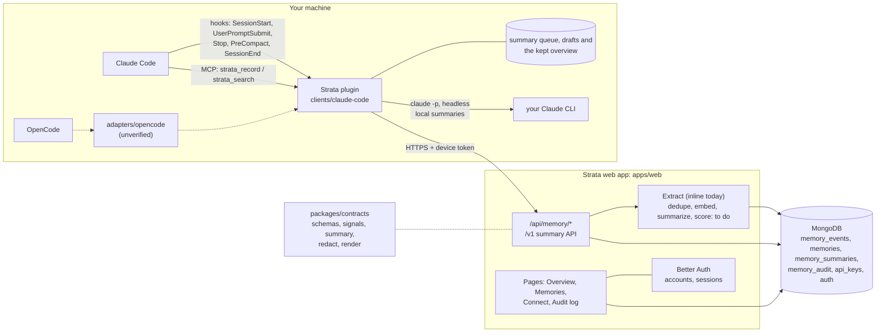

# Strata

Engineer-reviewed session summaries for coding agents. Strata captures what happens in your Claude Code sessions,
turns it into short summaries your team can search, and keeps the raw prompts and replies on your machine. Colleagues
get what was built, why, the decisions behind it, and the gaps worth documenting, with the Jira ticket and GitHub PR
attached.

The web app serves both the memory API and the `/v1` summary API the new client uses: device sign-in, projects,
approved session summaries, retraction, search and roll-ups. The memory API now speaks contract v1: versioned, typed
events that grow without breaking older clients. The plugin still drafts locally; moving drafting onto the server is
the next design step.

## What's built so far

**The web app** (Next.js 16, `apps/web`) has accounts with email and password, API keys you make per machine, and the
memory API: capture, recall, the frozen block, compaction summaries, save and forget. Every route checks a bearer key
first and validates its body against a shared contract. **MongoDB** (the Atlas-local image) holds events, memories,
summaries, an audit log and the keys, with a vector index for recall and a text index behind it.

**The Claude Code plugin** (`clients/claude-code`) is summary-first. It captures each prompt locally, queues the
redacted turn text when Claude finishes, and asks your own `claude -p` (headless, small model, no tools, no MCP) to
fold it into one session summary. Raw text is deleted as soon as the summary is written. You review and edit the
summary in a local dashboard, link the Jira ticket or PR, and approve it; only then does it leave the machine, one
`session_summary` event per revision. Claude also gets `strata_record` and `strata_search`, and each session starts
with a local overview of what earlier sessions in the repo learned.

**The pages** show what's remembered and where it came from, let you keep a candidate or forget a memory after seeing
exactly what goes with it, connect a client step by step, and list every change in an audit log, in light and dark and
on a phone.

The client is covered by 38 tests that run the hooks, CLI and dashboard as real processes against a mock server. The
memory API and the `/v1` summary API have unit and database tests. The rest is in the to-do below, which an
[Anything Factory](https://github.com/Erik-Koning/Anything-Factory) team is working through.

## Architecture



Only the API touches the database. The summary client talks to `/v1`. The memory API and its pages use
`packages/contracts`; the plugin carries its own summary schema and redaction for now.

**One session, as the plugin sees it:**

```mermaid
sequenceDiagram
  participant C as Claude Code
  participant P as Strata plugin
  participant L as local claude -p
  participant D as review dashboard
  participant A as Strata /v1
  C->>P: SessionStart
  P->>P: build the repo overview from earlier summaries
  P-->>C: overview as context, kept for this session
  loop every turn
    C->>P: UserPromptSubmit
    P->>P: redact and keep the prompt until Stop
    C->>P: Stop
    P->>P: queue the redacted turn; delete the prompt file
    P->>L: fold the turn into the session summary
    L-->>P: updated summary
    P->>P: delete the raw turn text
  end
  C->>P: PreCompact / SessionEnd
  P->>L: summarize anything still queued
  D->>P: edit, link Jira/PR, approve
  P->>A: POST /v1/events (approved session_summary, idempotent)
  A-->>P: { ok: true }
```

**The rule everything follows:** only an approved summary leaves the machine. The rest follows from it:

- prompts and replies are captured locally and never uploaded; the raw turn text is deleted as soon as it is
  summarized;
- a summary is sent only when the engineer approved it and it carries a Jira key, a PR, or an explicit "no ticket";
- secrets and `<private>` blocks are stripped before the summarizer sees anything, code is removed from summaries,
  and the server redacts again;
- the summarizer runs headless with no tools, no MCP, no slash commands, its own empty working directory, a small
  model, and a daily cap;
- the `SessionStart` overview is built from local summaries and kept for the session, so a resume gets the same bytes;
- each approved revision is uploaded with an idempotency key, and a retry never stores it twice.

The memory API's data model, who can do what, and how each hook maps to the client are in
[`docs/architecture.md`](docs/architecture.md).

| Part                     | Where                    | What it is                                                                              |
| ------------------------ | ------------------------ | --------------------------------------------------------------------------------------- |
| Web app and API          | `apps/web`               | Next.js 16, App Router, Better Auth, the MongoDB driver, Tailwind                       |
| Memory logic             | `apps/web/server/memory` | ingest, extract, recall, frozen, compress, forget, save                                 |
| AI provider              | `apps/web/server/ai`     | one interface; `stub` (deterministic, offline) is the only one yet                      |
| Claude Code plugin       | `clients/claude-code`    | hooks, session summaries, review dashboard, MCP server, OpenCode adapter; no build step |
| Contracts                | `packages/contracts`     | contract version, zod schemas, signals, summary, `redact`, render                       |
| Plugin marketplace       | `.claude-plugin`         | lets Claude Code install the plugin from this repository                                |
| The factory team's rules | `.a6g`                   | the brief, notes, rubric and adapters the team works to                                 |

## To-do

What's left, in the order the team is working through it. Each group is one journey in the team's task graph.

The groups from **Contracts** to **Pages for work records** come from the plan review of 14 November 2026
([`docs/plan.md`](docs/plan.md)). They turn Strata from personal agent memory into reviewed work records that a team
can read. They aren't in the team's task graph until `.a6g/brief.md` takes them.

**Done: the foundation**

- [x] Workspace: pnpm, TypeScript, Biome, Vitest; the gate the team's merge queue runs
- [x] Accounts, sessions and per-person API keys
- [x] MongoDB collections, indexes and the vector index, created by `pnpm db:indexes`
- [x] The memory API: events, recall, frozen, compress, forget (with a preview), save
- [x] Extraction: what the user says to remember becomes an active memory; anything else is a candidate
- [x] The Claude Code plugin: local capture, session summaries, review dashboard, redaction, MCP tools, marketplace
- [x] The pages: Overview, Memories, Connect, Audit log

**Summary backend**

- [x] `/v1/auth/device`, `/v1/auth/token`, `/v1/me`: device-code sign-in for the plugin
- [x] `/v1/projects`: projects and team membership
- [x] `/v1/events`: approved `session_summary` revisions only, idempotent, author from the token
- [x] `DELETE /v1/sessions/:id`, `/v1/search`, `/v1/rollups`
- [x] MongoDB collections for summaries, revisions, projects and the audit log
- [ ] The web pages read the summary store; Connect issues a plugin sign-in

**Test harness**

- [ ] Playwright suite and page checks (axe, overflow, touch targets) at desktop, laptop and phone, light and dark
- [ ] End-to-end journeys: sign up, make a key, a session's memory shown, keep a candidate, forget with its cascade

**OpenCode adapter**

- [ ] Verify the real `@opencode-ai/plugin` event names and fields against `adapters/opencode/strata.js`
- [ ] Install the adapter in a live OpenCode session and confirm a turn becomes a summary
- [ ] Acceptance through a fake OpenCode host, alongside the Claude Code hook tests
- [ ] Bundle `@strata/contracts` into the plugin if it adopts the versioned event contract: once installed outside
      this repository it can't import the workspace package

**Memory pipeline**

These belong to the memory API. The summary client no longer uses them; decide whether to keep or retire them when the
backend changes.

- [ ] Jobs on a schedule (`POST /api/jobs/run`): extract > dedupe > embed > summarize > score > policy
- [ ] Dedupe beyond identical text: near-duplicates, and `supersedes` when a memory replaces another
- [ ] Real providers behind `server/ai/provider.ts`: OpenAI embeddings, Anthropic for compress and extract
- [ ] Scoring and expiry: confidence that changes with use, `expiresAt`, archiving what goes stale
- [ ] `scripts/check-cache.ts`: proof with a real key that cache-read tokens don't drop after turn 2

**Governance**

- [ ] Summaries shown and forgettable, with what they were made from
- [ ] Provenance one click away: the session, the message and the event behind a memory
- [ ] Memories for every project (`*`) set from the page; editing a memory as a superseding one
- [ ] Bulk keep and archive for candidates; pagination tested at scale

**Contracts**

- [x] A payload schema for each event kind, in place of `z.record(z.string(), z.unknown())`; each event checked on
      its own, so one bad event is refused alone (202 with `rejected`)
- [x] A contract version on every event (`v`, now 1); within a version changes only add; kinds, versions and fields
      the API doesn't know yet are kept, not refused; `upgrade_required` (426) for clients too old
- [x] The `finding` event (what `record_finding` sends) and generic links (`Ref`: ticket, PR, commit, doc)
- [ ] Record shapes the API answers with: kind, status, sources, the review update (with `/api/records`)
- [x] Example events (`@strata/contracts/examples`) that the contract's and the API's tests accept
- [ ] A plugin test that every event its hooks queue parses as known: the summary-first client does not emit memory
      events yet; this returns with the capture rework

**Records and review**

The current client drafts locally and uploads only approved summaries. These server-side record features are the
contract-v1 direction, not yet implemented.

- [ ] A `records` collection: kinds `summary`, `insight`, `workflow`, `pain_point`, `context_gap`; statuses `draft`,
      `approved`, `discarded`; an edited flag; the session, product and links; the events each record came from
- [ ] An Anthropic provider behind `server/ai/provider.ts` that drafts a session's records when the session ends
- [ ] `/api/records`: list, read, edit, approve, discard; only the author sees a draft
- [ ] MCP tool `record_finding`, so the agent logs an insight, workflow finding, pain point or context gap when it
      runs into one (a `finding` event through the outbox), and a skill that says when to use it
- [ ] Approved insights and workflow findings copied into memories, so the next session recalls them
- [ ] Prompt, reply and transcript text deleted as soon as a session is drafted. Decided 14 November 2026: drafting
      runs on the server, from redacted text, and a draft is its author's alone until they approve it
- [ ] Choose the embeddings model: OpenAI, as the brief proposes, or Voyage AI

**Capture for work records**

Contract v1 implemented these in the client this branch replaced. Porting them into the summary-first plugin is part
of the next step.

- [ ] Session links from the plugin: repository, branch, HEAD commit, folder, and ticket keys parsed from the branch
      name; sent at the start and again when the branch or commit changes
- [ ] Tool signals without content: how long each call ran; for a shell command, its kind (test, build, typecheck,
      lint, format, install, git), its exit code when it failed, and a fingerprint to count re-runs
- [ ] The pull request for a session's branch, looked up on GitHub (read-only)
- [ ] The session-start block also carries the product overview and open context gaps (fetched at startup only, so
      the cache rule holds)

**Teams and products**

- [ ] Organisations, teams and members, in place of the single `default` organisation
- [ ] Roles: engineer, viewer (managers and PMs), admin, with a permission filter on every read
- [ ] A `products` collection mapping repositories to products
- [ ] `/api/products/:id`: the overview, tickets and PRs, and approved records

**Roll-ups**

- [ ] Ticket and PR summaries, made from approved records only, with the ids of the records behind them
- [ ] Product overviews, rewritten from the layer below on each roll-up

**Pages for work records**

- [ ] Review queue: drafts grouped by session; approve, edit, discard, bulk approve
- [ ] Session page: the summary, its findings, its links, and where each finding came from
- [ ] Products: a list, then each product's overview, tickets and PRs, insights, workflow notes, pain points and open
      gaps
- [ ] Friction: pain points and context gaps grouped by repository, with how often each repeats
- [ ] What others see about me: a person's view of exactly what viewers see about their work
- [ ] Organisation settings: members, roles, and which repository belongs to which product
- [ ] Overview reframed around what's awaiting review, products and friction; Memories renamed Agent memory

**Shipping**

- [ ] Dockerfile for `apps/web` (standalone, not root, health check)
- [ ] GitHub Actions running the gate and the end-to-end suite against an Atlas-local service container
- [ ] `docs/architecture.md`: backups and restore (`mongodump`), HTTPS, logs, Dependabot
- [ ] Rate limits on the API, and a size limit on event batches

## Run it

You need Node 24, pnpm and Docker.

```sh
pnpm install
docker run -d --name strata-mongo -p 127.0.0.1:27017:27017 mongodb/mongodb-atlas-local:8.0
cp .env.example apps/web/.env.local   # then set MONGODB_URI=mongodb://localhost:27017/strata?directConnection=true
pnpm db:indexes
pnpm dev                              # http://localhost:9316 by default (PORT)
```

Install the plugin, then open its dashboard with `/strata:dashboard`:

```
/plugin marketplace add Erik-Koning/Strata
/plugin install strata@strata
```

The plugin writes summaries locally, keeps a per-repo overview, and lets you review, edit and link work. Start the app,
then run `/strata:login` in Claude Code: it opens `/activate`, and after you approve the code the plugin can send
approved summaries. Settings, sign-in and review live in the dashboard; `STRATA_URL` and `STRATA_HOME` are optional
environment overrides. More in [`clients/claude-code/docs/api-contract.md`](clients/claude-code/docs/api-contract.md).

## The API

The web app serves two APIs. The memory API uses contract v1 (versioned events; below). The summary API is what the
Claude Code plugin uses: [`clients/claude-code/docs/api-contract.md`](clients/claude-code/docs/api-contract.md).

| Route                                         | Body / query                    | Answer                                   |
| --------------------------------------------- | ------------------------------- | ---------------------------------------- |
| `POST /v1/auth/device`, `POST /v1/auth/token` | `{ client }`, `{ device_code }` | device sign-in; the token is an API key  |
| `GET /v1/me`, `GET /v1/projects`              |                                 | the person, their projects               |
| `POST /v1/events`                             | approved `session_summary`      | 201 first, 200 duplicate, `{ ok: true }` |
| `DELETE /v1/sessions/:id`                     |                                 | retract every revision                   |
| `GET /v1/search`, `GET /v1/rollups`           | `q`, `projectId`                | teammates' approved summaries            |

The memory API's routes take `Authorization: Bearer <key>` and answer `{ error: { code, message } }` when they fail.
The scope is `{ project }`; the organisation and the person come from the key.

Every event carries the contract version it was written to (`v`). The contract only grows within a version, and the API
keeps what it doesn't understand yet rather than refusing it: the rules are in
[`docs/architecture.md`](docs/architecture.md#the-contract-and-how-it-changes).

| Route                       | Body                                                                     | Answer                                                    |
| --------------------------- | ------------------------------------------------------------------------ | --------------------------------------------------------- |
| `POST /api/memory/events`   | `{ batch: [{ v, id, sessionID, scope, kind, payload, ts, promptID? }] }` | 202 `{ accepted, duplicates, rejected }`, deduped on `id` |
| `POST /api/memory/recall`   | `{ sessionID, scope, query, k }`                                         | `{ memories: [{ _id, kind, text }] }`                     |
| `GET /api/memory/frozen`    | `?sessionID&project`                                                     | `{ memories }`, the same for the same data                |
| `POST /api/memory/compress` | `{ sessionID, scope, messages }`                                         | `{ summary }`                                             |
| `POST /api/memory/forget`   | `{ scope, ids \| query, dryRun? }`                                       | what went: memories, summaries, events                    |
| `POST /api/memory/save`     | `{ scope, text, kind }`                                                  | 201 `{ memory }`                                          |
| `GET /api/health`           |                                                                          | `{ ok, db, search, contract: { min, max } }`              |

## Develop

| Command                | What it runs                                                       |
| ---------------------- | ------------------------------------------------------------------ |
| `pnpm typecheck`       | TypeScript across the web app and contracts                        |
| `pnpm lint`            | Biome (lint and format), read-only. `pnpm format` fixes            |
| `pnpm test`            | Unit tests and the client suite: no database, no external network  |
| `pnpm test:db`         | API and database tests on a database of their own on `MONGODB_URI` |
| `pnpm test:acceptance` | The client's hooks, CLI and dashboard as real processes            |
| `pnpm build`           | `next build` (the plugin has no build step)                        |
| `pnpm db:indexes`      | Every index, the vector index included, idempotently               |
| `pnpm db:seed`         | Made-up memories for the pages                                     |

Embeddings and summaries go through one interface (`apps/web/server/ai/provider.ts`). The default, `stub`, is
deterministic and offline, so every test runs without a key.

Built by an [Anything Factory](https://github.com/Erik-Koning/Anything-Factory) team; its rules and brief are in
`.a6g/`.
